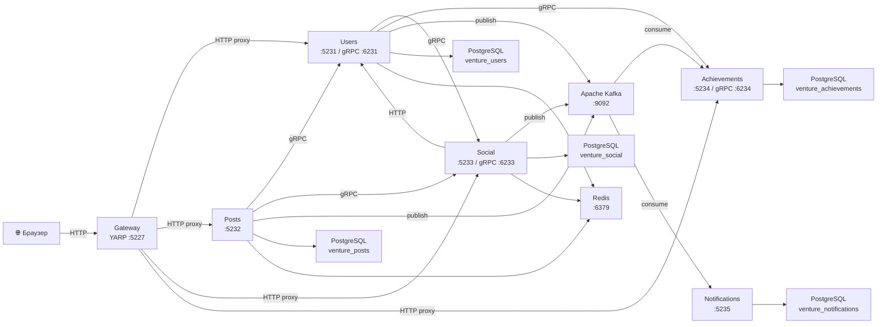
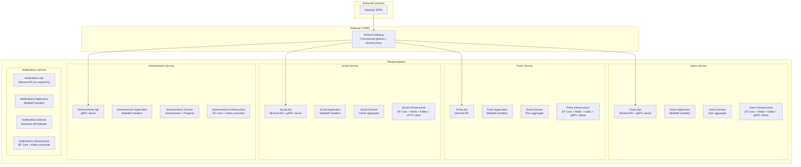

# 01 — Обзор системы

Дата аудита: 2026-10-18

## Краткое описание

**Venture** — социальная сеть для отслеживания профессионального и личностного развития. Функциональность: регистрация/авторизация, профиль с навыками, посты, подписки, лайки, лента, автоматические достижения.

Технологический стек: **.NET 10**, **PostgreSQL**, **Redis**, **Apache Kafka**, **gRPC**, **YARP**.

Система представляет собой **6 отдельных микросервисов** с разделением данных (database-per-service) и асинхронным взаимодействием через Kafka.

## System Context Diagram

## Container Diagram

## Основные технологические решения

| Решение | Обоснование | Оценка |
|---------|------------|--------|
| .NET 10 + Minimal API | Современный стек, легковесные эндпоинты | ✅ Оправдано |
| YARP как Gateway | Минимальная логика в шлюзе, просто прокси | ✅ Оправдано |
| Database-per-service | Строгое разделение данных между сервисами | ✅ Оправдано |
| MediatR (CQRS) | Разделение команд и запросов, pipeline behaviors | ⚠️ Оправдано, но есть дублирование кода |
| gRPC для синхронных вызовов | Типизированные контракты, быстрый протокол | ✅ Оправдано |
| Kafka для async событий | Надёжная доставка фактов, at-least-once | ✅ Оправдано |
| Redis для кэша | Быстрый доступ к лентам и профилям | ✅ Оправдано, но жёсткая зависимость |
| Clean Architecture в каждом сервисе | Разделение слоёв Domain → Application → Infrastructure → Api | ⚠️ Для данного размера избыточно, но консистентно |
| Отсутствие shared library | Каждый сервис дублирует абстракции | ⚠️ Компромисс: независимость vs дублирование |

## Принципы владения данными

Каждый сервис владеет своей базой PostgreSQL:

| Сервис | База | Владение |
|--------|------|----------|
| Users | `venture_users` | Пользователи, профили, навыки, хеши паролей |
| Posts | `venture_posts` | Посты, лайки |
| Social | `venture_social` | Подписки (follows) |
| Achievements | `venture_achievements` | Каталог достижений, прогресс, факты |
| Notifications | `venture_notifications` | Уведомления |
| Gateway | — | Нет собственной базы |

**Shared databases отсутствуют.** Это подтверждено архитектурным тестом `DatabaseOwnershipTests`.

## Границы сервисов

- **Users** — единственный источник правды о пользователях, JWT-токенах
- **Posts** — единственный владелец постов и лайков; при создании поста проверяет существование автора в Users через gRPC
- **Social** — владеет подписками; проверяет существование пользователя в Users через HTTP
- **Achievements** — реактивный сервис: принимает факты из Kafka (пост опубликован, подписка создана) и самостоятельно решает о выдаче достижений
- **Notifications** — чистый sink: принимает уведомления из Kafka и пишет в базу
- **Gateway** — статика + маршрутизация, бизнес-логики нет

## Основные архитектурные компромиссы

1. **Отсутствие Outbox Pattern**: публикация в Kafka происходит после коммита БД в PostCommitActions. Если Kafka недоступен, данные сохранены, но событие потеряно.

2. **Дублирование DDD-абстракций**: `AggregateRoot`, `ValueObject`, `Result`, `DomainEvent` и 4 MediatR-поведения продублированы в каждом из 5 сервисов (+ Activities). Независимость сервисов обеспечена, но при этом ~40% базового кода идентичен.

3. **Notifications без API для чтения**: уведомления записываются, но не отдаются клиенту — нет эндпоинта для чтения.

4. **Activities** — заглушка. Содержит только Domain с базовыми абстракциями, без Application/Infrastructure/Api. Сервис не запускается и не интегрирован.
