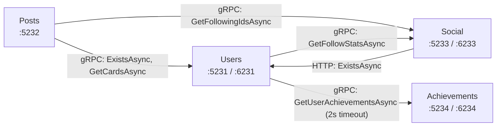
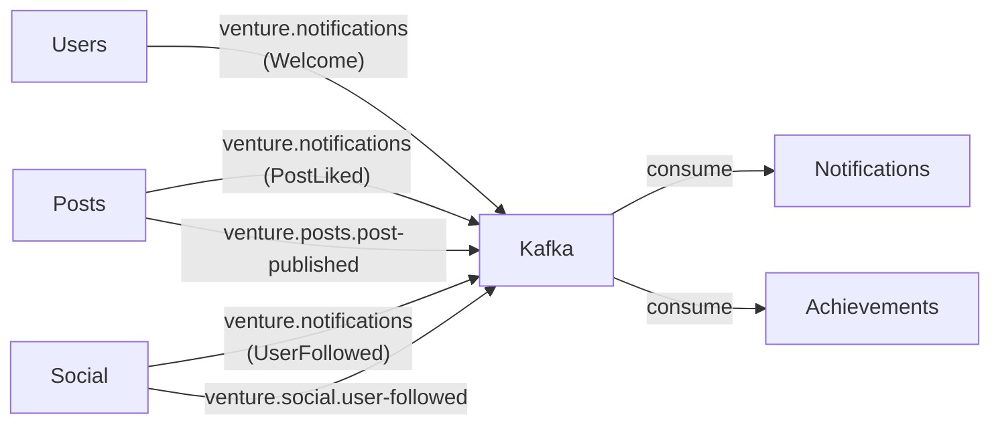

# 03 — Карта зависимостей

## Синхронные зависимости (gRPC / HTTP)

## Асинхронные зависимости (Kafka)

## Реестр межсервисных взаимодействий

### 1. Posts → Users (gRPC)

| Параметр | Значение |
|----------|----------|
| Источник | `Posts.Infrastructure.Integration.GrpcUserRepository` |
| Получатель | `Users.Api.Grpc.UserLookupService` |
| Протокол | gRPC (H2C, порт 6231) |
| Операции | `ExistsAsync(userId)`, `GetCardsAsync(userIds)` |
| Контракт | `users.proto` |
| Причина | Проверка автора при создании поста; получение карточек для ленты |
| При недоступности | **gRPC exception → 500 Internal Server Error.** Нет circuit breaker, нет retry, нет fallback |
| Последствия изменения | Изменение proto → поломка Posts. Proto файл общий (ссылка через `../Users/Users.Api/Protos/`) |

### 2. Posts → Social (gRPC)

| Параметр | Значение |
|----------|----------|
| Источник | `Posts.Infrastructure.Integration.GrpcFollowedUsers` |
| Получатель | `Social.Api.Grpc.SocialLookupService` |
| Операции | `GetFollowingIdsAsync(userId)` |
| Причина | Лента: получить ID подписок пользователя |
| При недоступности | **gRPC exception → 500.** Лента полностью недоступна |

### 3. Social → Users (HTTP)

| Параметр | Значение |
|----------|----------|
| Источник | `Social.Infrastructure.Integration.HttpUserRepository` |
| Получатель | `Users.Api` HTTP endpoint |
| Протокол | **HTTP/1.1** (не gRPC!) |
| Операции | `ExistsAsync(userId)` |
| Причина | Проверка существования пользователя перед подпиской |
| При недоступности | **HTTP exception → 500** |
| Примечание | README прямо указывает: «Social по-прежнему спрашивает карточку пользователя у Users по HTTP» — это legacy, не перенесённое на gRPC |

### 4. Users → Social (gRPC)

| Параметр | Значение |
|----------|----------|
| Источник | `Users.Infrastructure.Integration.GrpcFollowStats` |
| Получатель | `Social.Api.Grpc.SocialLookupService` |
| Операции | `GetFollowStatsAsync(userId)` |
| Причина | Счётчики подписок для профиля |
| При недоступности | **gRPC exception → 500.** Профиль недоступен |

### 5. Users → Achievements (gRPC, graceful degradation)

| Параметр | Значение |
|----------|----------|
| Источник | `Users.Infrastructure.Integration.GrpcUserAchievementDisplay` |
| Получатель | `Achievements.Api.Grpc.AchievementLookupService` |
| Операции | `GetUserAchievementsAsync(userId)` |
| Timeout | **2 секунды** (явно задан в `AchievementDisplayClient.Timeout`) |
| При недоступности | **Graceful degradation**: профиль возвращается с пустым массивом достижений. Ошибки логируются |
| Оценка | ✅ Это единственное место с graceful degradation во всей системе |

### 6. Users/Posts/Social → Kafka (async publish)

| Параметр | Значение |
|----------|----------|
| Реализация | `KafkaProducer.PublishAsync<T>()` через `PostCommitActions` |
| Acks | `Acks.All` (полная репликация) |
| Idempotence | `EnableIdempotence = true` |
| MessageTimeout | 10 секунд |
| Момент отправки | **После коммита транзакции БД** |
| При недоступности Kafka | **Запрос завершается ошибкой** (`throw` при `NotPersisted`). Данные в БД уже закоммичены, но событие потеряно |

### 7. Kafka → Achievements (consume)

| Параметр | Значение |
|----------|----------|
| Реализация | `AchievementFactsConsumer` (BackgroundService) |
| Топики | `venture.posts.post-published`, `venture.social.user-followed` |
| AutoCommit | `false` — ручной коммит после обработки |
| При ошибке JSON | Сообщение пропускается, offset коммитится |
| При ошибке БД | Offset **не коммитится**, сообщение будет повторно обработано |
| При неизвестной версии | `throw UnsupportedFactSchemaException` → потребитель пересоздаётся через 5 секунд → **бесконечный retry** |
| Idempotency | Через `ProcessedFact` таблицу (проверка EventId) |

### 8. Kafka → Notifications (consume)

| Параметр | Значение |
|----------|----------|
| Реализация | `NotificationKafkaConsumer` (BackgroundService) |
| Топик | `venture.notifications` |
| AutoCommit | `false` |
| **Критический дефект** | Offset коммитится **даже при ошибке БД** (строка 91: `consumer.Commit(result)` вне try/catch обработки). Уведомление теряется! |

## Критические выводы

### Потенциальные циклические зависимости
**Нет прямых циклов.** Но есть взаимные синхронные вызовы Users ↔ Social (Users вызывает Social для подписок, Social вызывает Users для проверки). При одновременном отказе обоих — deadlock-like поведение.

### Чрезмерно центральный сервис
**Users** является критической зависимостью: Posts, Social, и сам Users (для профиля через Social/Achievements) зависят от него. Падение Users делает недоступными ленту, подписки и профили.

### Отсутствие resilience patterns
Кроме таймаута в 2 секунды для Achievements, **нет**:
- Circuit breaker
- Retry policy (кроме Kafka consumer reconnect)
- Bulkhead
- Rate limiting

### Потеря событий
Публикация в Kafka после коммита БД без Outbox pattern означает: если Kafka недоступен в момент публикации, событие **потеряно навсегда**. Данные в БД сохранены, но Achievements/Notifications не узнают об изменении.
