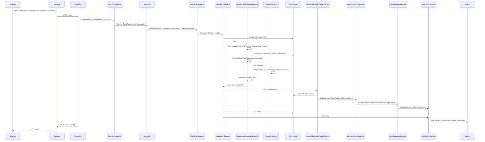
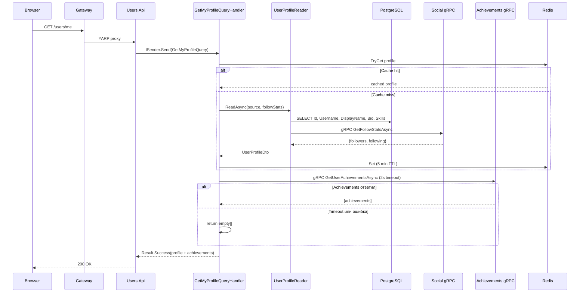

# 04 — Трассировка запросов

## Каталог сценариев

| # | Сценарий | Тип | Сервисы | Документ |
|---|----------|-----|---------|----------|
| 1 | Регистрация пользователя | Команда, cross-service (Kafka) | Users → Notifications | [01-register-user.md](flows/01-register-user.md) |
| 2 | Создание поста | Команда, cross-service (gRPC + Kafka) | Posts → Users → Achievements | [02-create-post.md](flows/02-create-post.md) |
| 3 | Подписка на пользователя | Команда, cross-service (HTTP + Kafka) | Social → Users → Achievements + Notifications | [03-follow-user.md](flows/03-follow-user.md) |
| 4 | Чтение ленты | Запрос, multi-service (gRPC + Redis) | Posts → Social + Users | [04-get-feed.md](flows/04-get-feed.md) |
| 5 | Чтение профиля | Запрос, multi-service (gRPC) | Users → Social + Achievements | Описан ниже |

## Сценарий 1: Регистрация пользователя

### Путь выполнения

**A. Точка входа**
- `POST /users` — `RegisterUserEndpoint` (`Users.Api/Endpoints/Users/RegisterUserEndpoint.cs:11-25`)
- AllowAnonymous — нет JWT-проверки
- Request: `{email, username, displayName, password}`

**B. MediatR Pipeline**
1. `LoggingBehavior` — логирует начало/конец (`Users.Application/Behaviors/LoggingBehavior.cs`)
2. `PerformanceBehavior` — замеряет время (`Users.Application/Behaviors/PerformanceBehavior.cs`)
3. `ValidationBehavior` — запускает `RegisterUserCommandValidator` (FluentValidation)
4. `TransactionBehavior` — открывает транзакцию, вызывает handler, SaveChanges, Commit, PostCommit

**C. Обработчик**
- `RegisterUserCommandHandler` (`Users.Application/Users/Commands/RegisterUser/RegisterUserCommandHandler.cs:11-55`)
- Создаёт value objects: `Email`, `Username`, `DisplayName`
- Проверяет уникальность username и email через `IUserRepository`
- Хеширует пароль через `IPasswordHasher` (PBKDF2, 100k итераций, SHA-256)
- Вызывает `User.Register()` — доменный агрегат

**D. Домен**
- `User.Register()` (`Users.Domain/Users/User.cs:60-96`)
- Проверяет null-параметры
- Генерирует `UserId.New()` (Guid)
- Регистрирует `UserRegisteredDomainEvent`

**E. Сохранение и события**
- `TransactionBehavior` вызывает `SaveChangesAsync` → `VentureDbContext` переопределяет его
- `VentureDbContext.SaveChangesAsync` (`Users.Infrastructure/Persistence/VentureDbContext.cs:29-48`):
  1. Собирает domain events
  2. Выполняет `base.SaveChangesAsync()` — INSERT в БД
  3. Публикует events через `DomainEventDispatcher`
  4. Если появились новые изменения — повторный SaveChanges
- Event handler для `UserRegisteredDomainEvent` ставит в `PostCommitActions` задачу записи в Kafka
- После коммита транзакции `PostCommitActions.RunAsync()` публикует `Welcome` в `venture.notifications`

**F. Риски**
- Если Kafka недоступен: пользователь создан, но Welcome-уведомление потеряно
- Race condition на уникальность username/email: проверка и INSERT не атомарны (но unique-индекс в БД защищает от дублей через exception)

---

## Сценарий 5: Чтение профиля (краткое описание)

**Путь**: `GET /users/me` или `GET /users/{username}` → Users.Api

**Ключевой момент**: достижения **не кэшируются** — они запрашиваются каждый раз. Профиль (без достижений) кэшируется на 5 минут.

## Непроверенные сценарии

- Удаление поста (DeletePostCommandHandler)
- Редактирование поста (EditPostCommandHandler)
- Unlike поста (UnlikePostCommandHandler)
- Отписка (UnfollowUserCommandHandler)
- Загрузка аватара/шапки (обходит MediatR)
- Вход пользователя (Login — проверен на уровне handler, без диаграммы)
