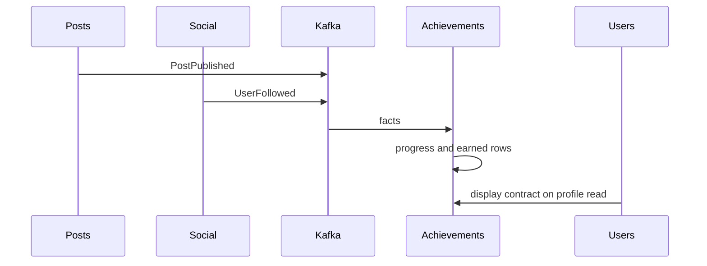

# Целевая архитектура Venture

Этот документ фиксирует решения по согласованному разбору и план перехода. Рабочий код, контракты, схемы баз и тесты им не изменялись.

Следующий код начинается только по отдельному запросу на конкретный этап. До этого запроса этап 1 не считается разрешённым.

## Зафиксированные решения

### 1. Владелец выдачи

Сервис Achievements владеет правилами, внутренним прогрессом и фактом «пользователь получил достижение».

Posts и Social сообщают только факты своей области: пост опубликован, пользователь подписался. В этих фактах нет типа достижения и нет просьбы что-то выдать.

Users больше не решает, когда выдавать значок, и не хранит копию `AchievementType`.

Так закрывается текущий разрыв. Сейчас каталог лежит в [Achievement.cs](../services/Achievements/Achievements.Domain/Achievements/Achievement.cs), правило `count == 1` — в [GrantFirstPostAchievementCommandHandler.cs](../services/Users/Users.Application/Achievements/Commands/GrantFirstPostAchievement/GrantFirstPostAchievementCommandHandler.cs) и парном handler подписчика, а Posts публикует не факт поста, а команду в топик `venture.achievements.first-post` из [RequestFirstPostAchievementHandler.cs](../services/Posts/Posts.Application/Posts/EventHandlers/RequestFirstPostAchievementHandler.cs).

### 2. Откуда профиль берёт достижения

`GET /users/me` и `GET /users/{username}` по-прежнему возвращают массив `achievements`. Страница в [app.js](../services/Gateway/Venture.Gateway/wwwroot/js/app.js) менять не нужно: она показывает `name`, `description`, `type` и `earnedOnUtc`.

Users заполняет этот массив в момент чтения профиля, вызывая контракт показа Achievements. Users не хранит правила и не разбирает `type` как свой enum. Для него это строка, которую нужно передать в JSON.

Задержка в несколько секунд после поста или подписки допустима. Значок не входит в ответ «пост создан» или «подписка создана». Так система работает и сейчас: выдача идёт через Kafka после коммита.

Отдельное условие из-за текущего кэша. [CacheDurations.cs](../services/Users/Users.Application/Caching/CacheDurations.cs) хранит весь профиль 5 минут, включая достижения. Инвалидация происходит в Users, потому что `User.GrantAchievement` поднимает `UserProfileChangedDomainEvent`. После переноса выдачи этого события в Users не будет. Если оставить достижения внутри той же Redis-записи, значок будет появляться с опозданием до пяти минут.

Поэтому достижения читаются при каждом открытии профиля и не записываются в пятиминутный кэш. Остальные поля профиля кэшируются как сейчас.

Если Achievements недоступен или не ответил за отведённое время, профиль всё равно возвращается, а `achievements` будет пустым. Ошибка пишется в лог. Вкладка на это время показывает «Пока нет достижений». Это сознательный выбор: страница профиля не должна падать вместе с каталогом. Сейчас сбой HTTP к Achievements роняет весь профиль, потому что [UserProfileReader.cs](../services/Users/Users.Application/Users/Queries/GetUserProfile/UserProfileReader.cs) не изолирует этот вызов.

Шлюз по-прежнему не маршрутизирует браузер в Achievements. Вызов остаётся серверным, из Users в `http://localhost:5234`.

### 3. Продуктовые правила этой миграции

Новая концепция достижений в этот переход не входит. Иначе перенос данных и смена правил смешаются, и откат станет неясным. Правила ниже повторяют текущее поведение и исправляют уже существующий дефект проверки «ровно один прямо сейчас».

- Значка два: «Первый пост» и «Первый подписчик». Названия и описания остаются теми, что задаёт [AchievementCatalogSeeder.cs](../services/Achievements/Achievements.Infrastructure/Persistence/AchievementCatalogSeeder.cs).
- Каждый значок выдаётся пользователю один раз.
- Achievements считает факты, которые сам принял. Первый пост — это первое принятое «пост опубликован» данного автора. Первый подписчик — первое принятое «на пользователя подписались». Порог «хотя бы один», а не «в чужой базе сейчас ровно один». Повтор того же факта счётчик не увеличивает.
- Удаление поста и отписка значок не забирают. В текущем коде `Post.Delete` не публикует событие отзыва, а `User.GrantAchievement` не умеет снимать выдачу. Факты `PostDeleted` и `UserUnfollowed` в эту миграцию не добавляются.
- Категорий, уровней и полосы прогресса в API нет. Прогресс — внутренний счётчик Achievements.
- Поле `type` в JSON профиля остаётся строкой для уже существующей вёрстки. Другие сервисы на него не ветвятся.
- Уведомление `AchievementEarned` по-прежнему никто не отправляет. Четыре копии `NotificationType` из-за этого не трогаем.
- Уже выданные строки из `venture_users.UserAchievements` копируются в базу Achievements до переключения чтения. Иначе при смене источника вкладка опустеет.
- Пользователь, который из-за проверки `count == 1` так и не получил значок, получит его на следующем подходящем факте после включения нового потребителя. Старые посты заново не проигрываются.
- Внутренний счётчик — это число фактов, увиденных после появления топика, а для уже скопированного значка пол равен 1. Это не полное историческое число постов за всё время. Будущее правило «10 постов» потребует отдельного пересчёта внутри Achievements и не потребует менять Users.

Добавить категорию, другой порог или отъём значка позже можно внутри Achievements. Posts и Social придётся менять только если им нужно начать сообщать новый факт своей области, например «пост удалён». Сам тип достижения в их код не возвращается.

## Что остаётся допустимой связью

- Posts перед созданием поста спрашивает Users, существует ли автор.
- Social перед подпиской спрашивает Users, существует ли цель.
- Лента в Posts читает список подписок Social и карточки авторов Users.
- Профиль Users читает счётчики подписок Social.
- Профиль Users читает контракт показа Achievements.

Это зависимости от стабильного ответа, а не от внутреннего устройства соседа.

## Целевая картина сервисов

Новых процессов нет. gRPC не добавляется. Общего проекта с доменными типами нет. Пять баз на одном PostgreSQL сохраняются. Отдельная СУБД на сервис не требуется: владение задаётся тем, кто пишет в свои таблицы, а не тем, на какой машине стоит сервер.



### Gateway

Ответственность: страницы и обратный прокси. Своих данных нет.

Публичные контракты не меняются. Маршруты остаются на Users, Posts и Social.

Событий нет. Зависимостей от домена нет.

Запрещено помещать в шлюз правила выдачи и сборку профиля из нескольких сервисов. Сборку профиля продолжает делать Users, потому что браузер уже получает один JSON профиля.

Развёртывание независимое. Этот переход шлюз не затрагивает.

### Users

Ответственность: аккаунт, профиль, навыки, JWT, файлы аватара и шапки.

Данные: база `venture_users`, таблицы `Users` и `UserSkills`. Таблица `UserAchievements` доживает до последнего шага и затем удаляется отдельной миграцией.

Внутренняя модель: агрегат `User` без коллекции достижений, без `GrantAchievement` и без `EarnedAchievement`.

Синхронные контракты наружу те же: регистрация, вход, профиль, навыки, загрузка медиа, внутренние карточки пользователей. В профиле массив `achievements` остаётся прежним по форме:

- `id`
- `type`
- `name`
- `description`
- `earnedOnUtc`

Публикуемые события: по-прежнему `Welcome` в `venture.notifications`. Событий о достижениях Users не публикует и не читает.

Потребляемые события: после снятия старого пути — никаких achievement-топиков.

Зависимости: Social за счётчиками подписок; Achievements за контрактом показа. Вызовы «сколько постов» и «сколько подписчиков» для выдачи значка удаляются. Проверка существования пользователя со стороны Posts и Social остаётся.

Запрещено: ссылка на проекты Achievements, свой `AchievementType`, правило порога, хранение прогресса, топики `venture.achievements.*`.

Граница транзакции: одна команда Users по-прежнему коммитит только свои таблицы через `TransactionBehavior`. Чтение достижений происходит вне этой транзакции, в запросе профиля.

Тесты: доменные тесты `GrantAchievement_*` в [UserTests.cs](../services/Users/Users.Domain.Tests/Users/UserTests.cs) переносятся по смыслу в Achievements и из Users удаляются вместе с методами. Для профиля нужен тест: при ответе Achievements массив заполняется, при ошибке вызова профиль успешен и массив пуст, повторное чтение из Redis не возвращает старый список достижений.

Развёртывание: Users переключается на новое чтение только после того, как Achievements уже отдаёт и скопированные, и новые выдачи.

### Posts

Ответственность: посты, медиа, лайки, лента.

Данные: `venture_posts`. Чужие таблицы не читает.

Внутренняя модель: `Post` и `PostPublishedDomainEvent` остаются. Доменное событие по-прежнему несёт `PostId` и `AuthorId`. Время факта проставляет издатель в момент отправки.

Синхронные контракты: создание, правка, удаление, лайк, лента, внутреннее число постов автора. Внутренний счётчик остаётся: он может пригодиться ленте и будущему разовому пересчёту. В рантайме выдачи значка он больше не участвует.

Публикуемые события:

- `venture.notifications` с типом `PostLiked`, как сейчас.
- `venture.posts.post-published`, новый факт.

Потребляемых событий нет.

Зависимости: Users «автор существует», Social «список подписок», Users «карточки авторов». Зависимости от Achievements нет.

Запрещено: имена достижений, топик `venture.achievements.first-post`, метод `RequestFirstPostAchievementAsync`.

Граница транзакции: коммит поста, затем публикация через уже существующий `PostCommitActions`. Окно потери между коммитом и Kafka на этом переходе не закрывается. Отдельный outbox — поздний этап, его не смешивают с переносом владельца.

Тесты: сериализация факта содержит ровно оговорённые поля; обработчик публикации поста ставит факт в очередь после коммита; в тесте нет словаря типов достижений.

Развёртывание: Posts можно выкатить отдельно. Пока старый топик публикуется параллельно, Users продолжает выдавать значки по-старому.

### Social

Ответственность: подписка и отписка.

Данные: `venture_social`, таблица `Follows`.

Внутренняя модель: `Follow`, `UserFollowedDomainEvent`, `UserUnfollowedDomainEvent`. Отписка по-прежнему только меняет свою базу и кэш. Наружу в этой миграции уходит только факт новой подписки.

Синхронные контракты: follow и unfollow через шлюз, внутренние following, stats и followers count. Счётчик подписчиков остаётся для профиля Users. Для выдачи значка он больше не вызывается.

Публикуемые события:

- `venture.notifications` с типом `UserFollowed`.
- `venture.social.user-followed`, новый факт.

Потребляемых событий нет.

Зависимости: Users «цель существует». Зависимости от Achievements нет.

Запрещено: `RequestFirstFollowerAchievementAsync` и топик `venture.achievements.first-follower`.

Граница транзакции и окно публикации те же, что у Posts.

Тесты: симметричны тестам Posts для факта подписки.

Развёртывание независимое и может идти отдельно от Posts.

### Achievements

Ответственность: каталог значков, правило выдачи, учтённые факты, выданные значки, ответ «что показать в профиле».

Данные: база `venture_achievements`.

- `Achievements` — каталог, уже есть.
- `UserAchievementStates` — одна строка на пользователя: `UserId`, `PostsObserved`, `FollowersObserved`.
- `EarnedAchievements` — `UserId`, `AchievementId`, `EarnedOnUtc`. Уникальная пара пользователь + значок.
- `ProcessedFacts` — `EventId` как первичный ключ и время приёма. Это защита от повторной доставки, а не доменное понятие «достижение».

Внутренняя модель:

- Каталог `Achievement` и enum `AchievementType` остаются внутри `Achievements.Domain`. Снаружи enum не копируется.
- На пользователя есть состояние прогресса. Команда «учти опубликованный пост» в одной транзакции вставляет `ProcessedFacts`. Если такой `EventId` уже есть, команда успешно завершается и больше ничего не меняет. Если факт новый, счётчик постов увеличивается. Когда счётчик стал не меньше 1 и значок «Первый пост» ещё не выдан, добавляется строка выдачи. Для подписки то же самое со счётчиком подписчиков.
- `EarnedOnUtc` — время решения внутри Achievements, своим часом. Так же сейчас делает Users: `dateTimeProvider.UtcNow` в handler выдачи. Время самого поста в значок не переносится.

Синхронный контракт:

`GET internal/users/{userId}/achievements`

Ответ `200` и массив. Пустой массив, если выдач нет. Не `404`.

Элемент массива совпадает с тем, что уже ждёт профиль: `id`, `type`, `name`, `description`, `earnedOnUtc`. `type` — строка каталога, сегодня это имя enum (`FirstPost`). Сортировка по `earnedOnUtc` по убыванию, как сейчас делает `UserProfileReader`.

Старые `GET internal/achievements/by-type/{type}` и `GET internal/achievements?ids=` живут, пока их вызывает Users, и удаляются в последнем этапе.

Авторизации на внутренних маршрутах по-прежнему нет. Achievements и сейчас без JWT. Новый маршрут остаётся внутренним.

Публикуемые события: нет. `AchievementEarned` не добавляется.

Потребляемые события: `venture.posts.post-published` и `venture.social.user-followed`. Группа `venture-achievements`. Ключ сообщения — id пользователя, к которому относится факт, чтобы его факты попадали в один раздел.

Зависимости рантайма от Posts, Social и Users нет. Разовый перенос старых строк — это операция миграции, не постоянный клиент.

Запрещено: вызывать Posts или Social, чтобы заново спросить текущий счётчик; хранить текст поста, имя пользователя и правило в теле входящего факта; отдавать наружу внутренний прогресс.

Граница транзакции потребителя: одна транзакция базы на сообщение (факт, счётчик, возможная выдача). Смещение Kafka коммитится после успешного коммита базы. Повтор после сбоя между коммитом базы и коммитом смещения безопасен: тот же `EventId` уже в `ProcessedFacts`.

Ошибка базы смещение не двигает: внешний цикл повторяет чтение, как сейчас у [AchievementKafkaConsumer.cs](../services/Users/Users.Infrastructure/Messaging/AchievementKafkaConsumer.cs). Нечитаемый JSON логируется и пропускается со сдвигом смещения, иначе одно битое сообщение остановит раздел. Неподдерживаемый `schemaVersion` смещение не двигает и пишется в лог: такой факт нельзя молча выбросить. Отдельной dead-letter очереди в текущем стеке нет, и для этого перехода она не вводится.

Тесты домена и application:

- первый факт выдаёт значок;
- второй другой пост того же автора второй раз не выдаёт;
- повтор того же `eventId` не увеличивает счётчик;
- факт подписки не выдаёт значок поста;
- пользователь, которому значок уже скопирован, не получает его повторно.

Развёртывание: процесс Achievements выкатывается раньше, чем Users меняет чтение профиля. В проект Infrastructure добавляется `Confluent.Kafka` той же мажорной линии, что у Posts, Social и Users. Свой `*.slnx` остаётся.

### Notifications

Ответственность: принять сообщение из `venture.notifications` и сохранить уведомление. Публичного API нет.

Данные: `venture_notifications`.

Контракт сообщения не меняется: `recipientId`, `type`, `actorId`, `referenceId`, `createdAtUtc`.

Идемпотентность остаётся в [NotificationWriter.cs](../services/Notifications/Notifications.Infrastructure/Persistence/Repositories/NotificationWriter.cs): повтор с теми же полями не создаёт вторую строку.

Запрещено учить Notifications правилам достижений. Когда-нибудь значок понадобится в ящике уведомлений — тогда Achievements напишет в уже существующий топик строку с типом `AchievementEarned`. Это отдельное решение, не часть текущего перехода. До него четыре копии enum не служат причиной что-то менять.

## Контракты фактов

Сериализация — существующий `KafkaJson`: `JsonSerializerDefaults.Web`, camelCase. Неизвестные поля читатель игнорирует. Новое необязательное поле совместимо. Переименование и удаление поля — уже новая версия, и старый читатель должен ещё понимать прежнюю.

`eventId` детерминированный. Для поста это `postId`. Для подписки это стабильная пара `followerId` и `followingId`. Повторная отправка того же факта не становится вторым событием. Случайный Guid на каждую попытку публикации хуже: будущий повтор из outbox мог бы посчитаться дважды.

В факт не входят текст поста, медиа, имена, тип достижения и текущий прогресс.

`venture.posts.post-published`, ключ — `authorId`:

```json
{
  "schemaVersion": 1,
  "eventId": "2c1f5b0e-7a0d-4c1a-9f2e-6b8d4a1c0e11",
  "occurredAtUtc": "2026-10-12T14:00:00Z",
  "postId": "2c1f5b0e-7a0d-4c1a-9f2e-6b8d4a1c0e11",
  "authorId": "8a0d1c2e-4b6f-4a11-9c33-1d2e3f4a5b6c"
}
```

`venture.social.user-followed`, ключ — `followingId`, то есть тот, на кого подписались:

```json
{
  "schemaVersion": 1,
  "eventId": "8a0d1c2e-4b6f-4a11-9c33-1d2e3f4a5b6c:1b2c3d4e-5f60-4718-92ab-c3d4e5f60718",
  "occurredAtUtc": "2026-10-12T14:05:00Z",
  "followerId": "1b2c3d4e-5f60-4718-92ab-c3d4e5f60718",
  "followingId": "8a0d1c2e-4b6f-4a11-9c33-1d2e3f4a5b6c"
}
```

Издатель и потребитель держат свои record-типы в своих проектах Infrastructure. Общей сборки контрактов нет. Совместимость проверяется одинаковым JSON-примером в тестах обеих сторон.

Корреляция: в лог издателя и потребителя пишутся `eventId`, id пользователя и имя топика. Отдельная система трассировки не вводится.

Старые топики на время перехода продолжают работать:

- `venture.achievements.first-post` с полем `authorId`
- `venture.achievements.first-follower` с полем `userId`

Они удаляются в последнем этапе, когда профиль уже читает Achievements и старый consumer Users остановлен.

## Карта зависимостей

Сейчас выдача значка:

- Posts пишет `venture.achievements.first-post`, Users читает и спрашивает Posts «сколько постов».
- Social пишет `venture.achievements.first-follower`, Users читает и спрашивает Social «сколько подписчиков».
- Users спрашивает Achievements `by-type/FirstPost` или `FirstFollower` и пишет `UserAchievements`.
- Профиль Users соединяет локальные выдачи с каталогом по id.

После перехода:

- Posts пишет `venture.posts.post-published`. Читает Achievements.
- Social пишет `venture.social.user-followed`. Читает Achievements.
- Users в рантайме выдачи больше никого не спрашивает.
- Профиль Users один раз читает `GET internal/users/{userId}/achievements`.
- Остальные синхронные связи ленты, существования пользователя и счётчиков подписок остаются.

Каскад, который исчезает: новый тип или новый порог внутри Achievements не требует правок Posts, Social и домена Users, пока входящие факты и JSON показа совместимы.

Связь, которая остаётся намеренно: Achievements зависит от формы двух фактов. Это зависимость от контракта владельцев поста и подписки. Если из факта пропадут `authorId` или `followingId`, потребителя придётся обновить явно и по версиям, а не искать чужой enum по репозиторию.

## Структура решения

Шесть существующих `*.slnx` сохраняются. Корневой общий solution не возвращается. Новых сервисов нет.

В `Achievements.Infrastructure` добавляются пакет Kafka и папки по уже существующему образцу Posts:

- `Messaging/KafkaOptions.cs`, `KafkaJson.cs`, `KafkaTopics.cs`, `PostPublishedMessage.cs`, `UserFollowedMessage.cs`
- `Messaging/AchievementFactsConsumer.cs`
- конфигурация `Kafka` в [appsettings](../services/Achievements/Achievements.Api/appsettings.json): `BootstrapServers`, `ClientId` и `GroupId` со значением `venture-achievements`

Доменные папки Achievements пополняются состоянием пользователя и выданной записью. Каталог не переписывается.

Users, Posts и Social в целевом состоянии теряют achievement-сообщения, но не получают новых проектов.

Переименование всех namespace `Venture.Domain` в имя сервиса в этот переход не входит. Одинаковые namespace сейчас не связаны, потому что сборки разные. Массовое переименование не создаёт границу и смешивает diff.

Общий `Venture.Contracts` не создаётся. Он снова заставил бы менять одну библиотеку ради любого поля события.

Application по-прежнему ссылается на EF Core и `IQueryable`. Это внутренний шов каждого сервиса. Этим переходом он не вычищается.

## Что сохранить, изменить и удалить

Сохранить:

- каталог, seeder, `Achievement`, `AchievementType` и `AchievementId` в Achievements;
- `Post.Publish` и `PostPublishedDomainEvent`;
- `Follow` и `UserFollowedDomainEvent`;
- HTTP-проверки существования пользователя;
- сборку ленты;
- `IFollowStats` и показ счётчиков в профиле;
- топик `venture.notifications` и writer уведомлений;
- шлюз и `app.js`;
- `PostCommitActions` до отдельного этапа outbox.

Изменить:

- Posts: рядом со старым handler добавить публикацию `venture.posts.post-published`, затем старый handler удалить;
- Social: так же для `venture.social.user-followed`;
- Achievements: consumer, таблицы прогресса и выдачи, новый внутренний GET;
- Users: `UserProfileReader` и оба query handler профиля берут показ из нового GET и не кладут его в Redis-запись профиля.

Удалить в последнем этапе, когда чтение уже переключено и подержано:

- [Users.Domain/Achievements](../services/Users/Users.Domain/Achievements);
- `EarnedAchievement`, `User.GrantAchievement`, `User.HasAchievement` и коллекцию в `User`;
- `OwnsMany` достижений в [UserConfiguration.cs](../services/Users/Users.Infrastructure/Persistence/Configurations/UserConfiguration.cs) и затем таблицу `UserAchievements`;
- `GrantFirstPostAchievementCommandHandler`, `GrantFirstFollowerAchievementCommandHandler`;
- `IAuthorPostCount`, `IFollowerCount`, `HttpAuthorPostCount`, `HttpFollowerCount`;
- `IAchievementCatalog.FindIdByTypeAsync` и `HttpAchievementCatalog` в текущем виде;
- [AchievementKafkaConsumer.cs](../services/Users/Users.Infrastructure/Messaging/AchievementKafkaConsumer.cs) и копии `FirstPostAchievementMessage` / `FirstFollowerAchievementMessage` в Users, Posts и Social;
- `RequestFirstPostAchievementHandler`, `RequestFirstFollowerAchievementHandler` и методы портов `IUsersIntegration`;
- константы старых топиков;
- `GET by-type` и `GET by ids`, когда вызовов не останется;
- доменные тесты выдачи на агрегате User.

`IFollowStats` не удаляется. Он нужен профилю, а не значку.

## Этапы

Каждый этап выкатывается отдельно. Следующий начинается, когда выполнен критерий предыдущего. Откат этапа — выкладка предыдущей версии своего сервиса, пока явно не удалена таблица.

### Этап 1. Факты рядом со старыми командами

Зависимость: нет. Achievements и Users не меняются.

Posts после коммита публикует и старый `venture.achievements.first-post`, и новый `venture.posts.post-published`. Social так же добавляет `venture.social.user-followed`, не снимая старый топик.

Критерий: в брокере на новый пост и новую подписку видны оба сообщения; старый значок по-прежнему появляется в профиле; `dotnet test` Posts и Social зелёный.

Тесты: сериализация JSON из раздела контрактов; handler ставит в `PostCommitActions` новый вызов и пока оставляет старый.

Откат: убрать новый handler. Старый путь цел. Новые топики можно оставить: их никто не читает.

### Этап 2. Achievements принимает факты и копирует старые выдачи

Зависимость: этап 1, чтобы новые факты уже публиковались. Потребитель с `AutoOffsetReset.Earliest`, как текущий consumer Users, дочитывает топик с начала, даже если процесс стартовал позже издателей.

Achievements создаёт три таблицы, поднимает consumer и применяет правила. Профиль всё ещё читает `UserAchievements`. Старый путь Users продолжает выдавать значки.

До переключения чтения копируются уже выданные строки: `UserId`, `AchievementId`, `EarnedOnUtc`. Идентификаторы каталога берутся из существующей базы, заново сидером не генерируются. Для скопированного «Первого поста» `PostsObserved` ставится в 1, для скопированного «Первого подписчика» — `FollowersObserved` в 1. Вставка идемпотентна по паре пользователь + значок.

Порядок: сначала запущенный consumer, затем копирование. Факт, пришедший во время копирования, либо уже создал выдачу, либо упирается в уникальность и не дублирует её.

Критерий: на новой учётной записи первый пост и первая подписка создают строку в `EarnedAchievements`; повтор сообщения её не дублирует; число скопированных строк совпадает с `UserAchievements`; профиль в UI всё ещё идёт из Users.

Тесты: список из раздела Achievements плюс тест уникальности `ProcessedFacts`.

Откат: остановить consumer Achievements. Профиль не задет. Новые таблицы можно не удалять.

### Этап 3. Профиль читает контракт показа

Зависимость: этап 2 и выполненное копирование. Иначе уже выданные значки исчезнут из вкладки.

Users заменяет сборку «локальные id + каталог по id» на `GET internal/users/{userId}/achievements`. Таймаут этого клиента — 2 секунды. Ошибка и таймаут дают пустой массив и запись в лог, остальные поля профиля возвращаются.

Кэш профиля по id и по username больше не содержит достижений. После попадания в кэш список запрашивается заново.

Старые handler выдачи в Users пока остаются. Благодаря этому откат чтения возвращает вкладку к локальной таблице, которая ещё пополняется.

Критерий: `app.js` показывает те же поля; новый значок виден при следующем открытии профиля после обработки Kafka и не ждёт пять минут; остановленный Achievements не превращает профиль в ошибку 500; старые пользователи видят скопированные значки.

Тесты Users: успешный ответ контракта, ошибка клиента, кэш не замораживает список.

Откат: вернуть `UserProfileReader` к локальной таблице. Consumer Users ещё работает.

### Этап 4. Снять старый путь

Зависимость: этап 3 подержан настолько, что откат чтения больше не нужен. Конкретную паузу задаёт отдельное согласие перед удалением таблицы. До этого согласия таблица не удаляется.

Сначала перестают публиковаться и читаться старые топики, удаляются перечисленные классы Users, Posts и Social. Users больше не пишет `UserAchievements`.

Отдельной миграцией после этого удаляется таблица `UserAchievements` и mapping в `UserConfiguration`. Это единственный шаг, который не откатывается выкладкой предыдущего бинарника. Его не соединяют с удалением классов в одном релизе.

Критерий: в Posts, Social и Users нет `AchievementType`, `GrantAchievement` и топиков `venture.achievements.*`; новый значок по-прежнему виден в профиле; `dotnet test` четырёх затронутых сервисов зелёный.

Откат до миграции удаления таблицы: выложить прежние Users, Posts и Social. После миграции удаления таблицы откат требует восстанавливать данные из резервной копии базы `venture_users`, поэтому этот подшаг и отделён.

### Позже и отдельно. Outbox

Не входит в этапы 1–4.

Сейчас после коммита `PostCommitActions` публикует Kafka из памяти. Падение процесса в этом окне оставляет сохранённый пост или подписку без факта. README это уже описывает. Transactional outbox в базе издателя закроет окно для постов, подписок и уведомлений. Делать его вместе с переносом значков не нужно: у отката смешаются две причины.

## Проверки, которые не пускают связность обратно

Их нет в репозитории до отдельного запроса на код. Первую проверку имеет смысл добавить в начале этапа 1: она уже сейчас должна быть зелёной и ничего не меняет в поведении.

Проект `services/ArchitectureTests` со своим `ArchitectureTests.slnx`. Он не ссылается на проекты сервисов. Он читает файлы репозитория.

1. У каждого `.csproj` под `services` путь `ProjectReference` не содержит другого имени сервиса (`Users`, `Posts`, `Social`, `Achievements`, `Notifications`, `Gateway`). Ссылка на свой слой разрешена.
2. С этапа 4 тот же тест дополнительно запрещает в `services/Users`, `services/Posts` и `services/Social` тексты `enum AchievementType`, `GrantFirstPostAchievement`, `GrantFirstFollowerAchievement`, `venture.achievements.first-post`, `venture.achievements.first-follower`.
3. Контрактный тест без общей библиотеки. В тестах Posts и в тестах Achievements лежит один и тот же JSON факта поста. Издатель сериализует record и сравнивает имена свойств. Потребитель десериализует тот же текст в свой record. Так же для факта подписки. Падение теста означает, что поле переименовали только с одной стороны.
4. Доменный тест Achievements на порог и идемпотентность остаётся постоянным. Он стережёт правило, которое раньше жило в Users и ломалось на `count == 1`.

`NetArchTest` и schema registry не требуются. Для этого репозитория достаточно чтения csproj и фиксированного JSON. Проверка «сервис не пишет в чужую базу» — это разные `Database=` в appsettings (`venture_users`, `venture_posts`, `venture_social`, `venture_achievements`, `venture_notifications`). Её можно добавить в тот же тестовый проект сравнением строк.

В CI каждый сервис по-прежнему гоняется своим `dotnet test services/<Имя>/<Имя>.slnx`. ArchitectureTests добавляется отдельной командой, когда проект появится.

## Риски, которые остаются после перехода

- Полной независимости не будет: профиль зависит от контракта показа, Achievements зависит от двух фактов.
- Пока нет outbox, потеря факта при падении после коммита возможна. Значок тогда не появится, пока факт не опубликуют снова.
- Во время этапов 1–3 значок пишется и в Users, и в Achievements. Источник для UI до этапа 3 — только Users. Расхождение в эти дни ожидаемо и не показывается.
- Пустой список при недоступном Achievements выглядит как «значков нет». Это цена живого профиля.
- Счётчик не является архивом всех постов за прошлое. Новое количественное правило нельзя строить на нём без отдельного пересчёта внутри Achievements.
- Удаление таблицы `UserAchievements` необратимо без резервной копии. Поэтому оно стоит последним и отдельным шагом.
